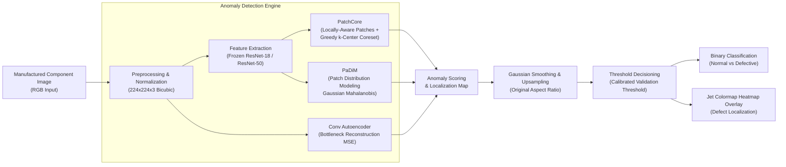

# Industrial Quality Inspection using Deep Anomaly Detection

[](https://github.com/HarshKumarShrimal/industrial-vision-anomaly-detection/actions/workflows/ci.yml)
[](LICENSE)
[](https://www.python.org/downloads/)
[](https://pytorch.org/)

An industrial-grade computer vision system for unsupervised anomaly detection and pixel-level defect localization in manufacturing lines. Implements and benchmarks **PatchCore**, **PaDiM**, and **Convolutional Autoencoders**, complete with a production FastAPI service, interactive inspection dashboard, CLI inference engine, and reproducible evaluation on synthetic and MVTec AD datasets.

---

## Architecture Overview



---

## Core Capabilities

- **Training-Free Unsupervised Inspection:** Fits exclusively on nominal (defect-free) parts to detect unpredictable defect types (cracks, scratches, contamination, voids).
- **Three Core Architectures:**
  - **PatchCore (CVPR 2022):** Locally-aware patch features with greedy k-center coreset subsampling and neighborhood-reweighted distance scoring.
  - **PaDiM:** Position-specific multivariate Gaussian modeling with Mahalanobis distance.
  - **Convolutional Autoencoder:** Reconstruction-error baseline.
- **Accurate Metric Evaluation:** Evaluates Image AUROC, Pixel AUROC, and Per-Region Overlap (PRO) with numerical stability fixes over upstream code.
- **Production FastAPI Service & Web UI:** REST endpoints (`/health`, `/predict`) plus a built-in browser UI for drag-and-drop defect inspection.
- **Cross-Platform Acceleration:** Automatically resolves Apple Silicon Metal Performance Shaders (`mps`), NVIDIA CUDA (`cuda`), or fallback CPU.
- **CPU-Friendly Smoke Benchmark:** Fast, deterministic synthetic verification harness running all three models in seconds without requiring multi-gigabyte dataset downloads.

---

## Smoke Benchmark Results

Measured locally on Apple M4 (16 GB unified memory, Python 3.10):

| Model | Image AUROC | Pixel AUROC | PRO (fpr=0.3) | Fit Time (s) | Total Elapsed (s) |
|---|:---:|:---:|:---:|:---:|:---:|
| **PatchCore** (ResNet-18, 20% Coreset) | **1.000** | **0.993** | **0.977** | 15.03s | 27.02s |
| **PaDiM** (ResNet-18, 32 dims) | **1.000** | **0.994** | **0.979** | 14.36s | 26.32s |
| **Conv Autoencoder** (32 Latent) | **1.000** | **1.000** | **1.000** | 72.23s | 84.11s |

*Full experiment results stored in `results/runs/smoke_benchmark_results.json`.*

---

## Repository Structure

```
industrial-vision-anomaly-detection/
├── .github/workflows/
│   └── ci.yml               # Automated CI test suite & smoke benchmark
├── configs/                 # YAML configuration files (patchcore, padim, autoencoder)
│   ├── default.yaml
│   ├── patchcore.yaml
│   ├── padim.yaml
│   └── autoencoder.yaml
├── docs/                    # Diagrams and architectural references
├── results/                 # Experiment metrics, plots, and inference heatmaps
│   ├── inference/           # Generated overlay heatmaps
│   └── runs/                # Benchmark JSON and CSV outputs
├── scripts/
│   ├── infer.py             # CLI single-image and batch inference
│   ├── serve.py             # FastAPI server launcher
│   ├── smoke_test.py        # Fast CPU synthetic benchmark runner
│   ├── run_benchmark.py     # Full MVTec AD benchmark runner
│   └── download_data.py     # MVTec AD HuggingFace downloader
├── src/iad/
│   ├── api.py               # FastAPI application & interactive Web UI
│   ├── inference.py         # InferencePipeline & heatmap blending
│   ├── runner.py            # High-level experiment orchestrator
│   ├── datasets/            # MVTec AD PyTorch dataset loader
│   ├── metrics/             # AUROC, PRO, and evaluation routines
│   ├── models/              # PatchCore, PaDiM, Autoencoder, FeatureExtractor
│   └── utils/               # Device resolution, seeding, coreset sampling
├── tests/                   # 19 unit & integration tests
├── UPSTREAM.md              # Upstream attribution & detailed contributions
├── INTERVIEW_NOTES.md       # 15 technical interview questions & answers
├── requirements.txt         # Pinned runtime dependencies
├── pyproject.toml           # Build system configuration
└── README.md
```

---

## Quickstart & Installation

### 1. Prerequisites & Environment Setup

```bash
# Clone repository
git clone https://github.com/HarshKumarShrimal/industrial-vision-anomaly-detection.git
cd industrial-vision-anomaly-detection

# Create and activate virtual environment
python3 -m venv .venv
source .venv/bin/activate

# Install dependencies
pip install --upgrade pip
pip install -r requirements.txt
```

### 2. Run Test Suite

```bash
PYTHONPATH=src pytest tests -v
```
*Executes all 19 unit and integration tests covering scoring, metrics, PRO curve interpolation, API endpoints, and input validation.*

### 3. Run CPU Smoke Benchmark

```bash
PYTHONPATH=src python scripts/smoke_test.py
```
*Generates synthetic nominal and defect components on the fly, trains all three architectures, evaluates Image AUROC, Pixel AUROC, and PRO, and outputs a comparison table.*

### 4. Single-Image Inference CLI

```bash
# Run inference on a sample image
PYTHONPATH=src python scripts/infer.py \
    --image data/sample/defect_sample.png \
    --method patchcore \
    --threshold 0.5 \
    --output-dir results/inference
```

Output:
```text
[ANOMALOUS] defect_sample.png | Score: 32.2899 (Thr: 0.5000) | Latency: 42.1ms -> Saved defect_sample_heatmap.png
```

### 5. Launch Interactive Inspection Web UI & REST API

```bash
python scripts/serve.py --host 127.0.0.1 --port 8000
```
Open your browser to `http://127.0.0.1:8000` to upload component images, adjust decision thresholds, and inspect real-time defect heatmaps.

API Health check:
```bash
curl -s http://127.0.0.1:8000/health | jq .
```

---

## Technical Engineering Contributions

1. **Fixed Upstream PRO Metric Failure:** Resolved a numerical integration defect in `src/iad/metrics/pro.py` where zero False Positive Rates collapsed trapezoidal integration widths, yielding false zero scores. Implemented monotonic FPR deduplication, boundary anchoring, and dense regular grid interpolation.
2. **Inference Pipeline with Heatmap Blending:** Built `src/iad/inference.py` to handle arbitrary image types, validate corrupt inputs, auto-fit default nominal baselines, and blend Gaussian-smoothed Jet colormaps over original image pixels.
3. **Interactive Inspection Service:** Created `src/iad/api.py` featuring a FastAPI REST API and embedded browser UI for interactive visual quality verification.
4. **Cross-Platform Device Resolver:** Implemented `src/iad/utils/device.py` enabling seamless acceleration on Apple Silicon (`mps`), NVIDIA (`cuda`), and CPU.
5. **Interview Preparation & Technical Documentation:** Authored [`INTERVIEW_NOTES.md`](INTERVIEW_NOTES.md) containing 15 in-depth technical questions with precise code-path citations.

---

## Licensing & Dataset Attribution

- **Code License:** [MIT License](LICENSE).
- **Upstream Attribution:** Based upon the foundational unsupervised architecture by Mohamed Taha ([mtaha-ai/industrial-anomaly-detection](https://github.com/mtaha-ai/industrial-anomaly-detection)). See [`UPSTREAM.md`](UPSTREAM.md) for full attribution and diff details.
- **Dataset License:** MVTec Anomaly Detection Dataset (MVTec AD) is developed by MVTec Software GmbH and released under the [Creative Commons Attribution-NonCommercial-ShareAlike 4.0 International License (CC BY-NC-SA 4.0)](https://creativecommons.org/licenses/by-nc-sa/4.0/). This repository does **not** redistribute raw MVTec AD images in version control.
